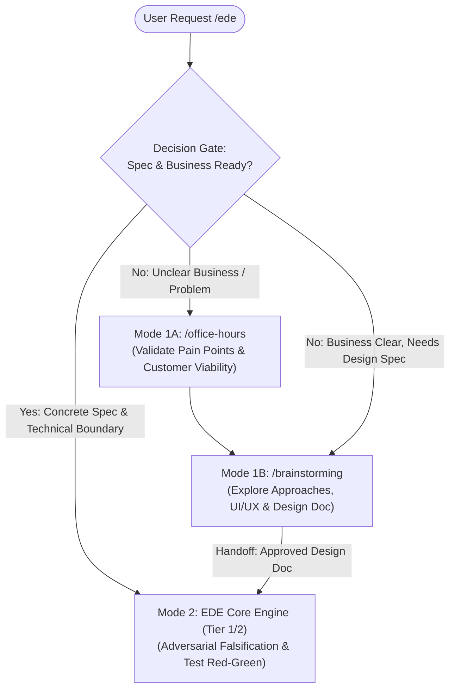

# EDE — Evidence-Driven Engineering (v3.1)

> "Never trust AI consensus alone. Demand independent, falsifiable runtime evidence."

EDE is an engineering workflow harness designed to eliminate the fundamental flaw of multi-agent coding: **shared model hallucinations and rubber-stamp approvals**. EDE v3.1 unites **Upstream Ideation Routing**, **Superpowers' TDD Red-Green discipline**, **gstack's adversarial role separation**, and **pstack's cross-model token economics** into our own proprietary, high-leverage verification moat.

---

## Phase 0: Decision Gate & Upstream Flow Integration

Before any adversarial claims or code tests begin, EDE evaluates the input request to determine the appropriate workflow mode. This ensures that abstract ideas are properly vetted by business and UX design before entering technical falsification.



### The 3 Uncertainty Tests (Mode Routing Rule)

1. **Problem & Value Uncertainty:** Is the target customer, business problem, or market viability unvalidated?
   - **Trigger:** High-level idea or open-ended strategic question.
   - **Enforcement:** **DO NOT execute any Dart testing scripts.** Route immediately to **`/office-hours`** (YC Founder/CEO mode) or **`/plan-ceo-review`**.
2. **Solution & UX Uncertainty:** Are user interaction flows, visual state handling, or trade-off approaches undecided?
   - **Trigger:** Validated business problem, but no concrete user flow or architecture approaches chosen.
   - **Enforcement:** Route immediately to **`/brainstorming`** to lay out approaches, compare trade-offs, and produce an approved Design Doc.
3. **Deterministic Implementation Readiness (Mode 2):** Are database schemas, calculation invariants, and API contracts already defined?
   - **Action:** Bypass upstream ideation $\rightarrow$ Enter **Mode 2 (EDE Core Engine)** directly.

### Artifact Handoff Protocol (Mode 1 ➔ Mode 2 Bridge)

When upstream ideation concludes, do not leave findings in ephemeral chat. Follow this strict handoff:

1. **Design Spec Synthesis:** Extract the approved approach, user story, and domain rules from `/brainstorming` into a clean markdown spec or plan.
2. **Automated Claim Generation:** Seed the EDE claim sheet with the upstream conclusions:
   ```bash
   dart run tool/ede/new_claim.dart "<feature_slug>" [tax-lawyer|cso|edge-breaker|concurrency]
   ```
3. **Pre-populate Invariants:** Transfer boundary rules and constraints identified during ideation directly into the YAML frontmatter of `.ede/claims/<claim-file>.yaml`.
4. **Transition to Falsification:** Transition directly into the Red Phase by authoring an adversarial test case based on the identified boundary risks.

---

## The 5 Core Pillars of EDE (v3.0)

1. **Multi-Model Blind Adversarial Falsification:**
   Auditors run in isolated context sandboxes on independent models. Instead of agreeing, reviewers act as specialized adversaries:
   - **`tax-lawyer`**: Attacks statutory compliance (ATO ITAA 1997 Division 28, TR 2021/1).
   - **`cso`**: Attacks security, auth, RLS, PII exfiltration, CSV/XML injection.
   - **`edge-breaker`**: Attacks floating-point rounding, negative values, spatio-temporal drift, clock skews.
   - **`concurrency`**: Attacks SQLite write-locks, offline sync races.
   See [references/adversarial-falsification.md](references/adversarial-falsification.md).

2. **Deterministic Red $\rightarrow$ Green Falsification Protocol:**
   An auditor claim is valid **ONLY** if it provides an executable counterexample test that demonstrably breaks the existing system (Exit code $\ne 0$). Once patched, the same test must pass cleanly (Exit code 0). No opinion or human debate can override runtime execution.

3. **Isolated Artifact Protocol (<4k Tokens/Round):**
   Subagents communicate exclusively through structured **Evidence Claim Sheets** (`.ede/claims/`). Zero conversational sprawl, zero context pollution. See [references/isolated-artifact-protocol.md](references/isolated-artifact-protocol.md).

4. **Dissent Preservation & Non-Violable SSOT:**
   If a single auditor generates a reproducible failing test, **the majority vote is discarded**. Dissent blocks deployment until resolved or legally disproven. See [references/dissent-arbitration.md](references/dissent-arbitration.md).

5. **Decision Provenance & Debt Ledger:**
   Every architectural resolution is permanently logged in `.ede/ledger/` with test stdout evidence. Any deferred shortcut is recorded in `.ede/debt.yaml` with an explicit TTL and ship-blocking flag.

---

## Invariant Hierarchy (Single Source of Truth Rule)

1. **Tier A (External Statutory Truth):** ATO Tax Laws, ITAA 1997, TR 2021/1. Code can never alter Tier A.
2. **Tier B (Core Domain Entities):** `VehicleExpense`, `Trip`, `AuditRecord`. Enforces data structural integrity.
3. **Tier C (Authoritative Business Engine):** `TaxCalculatorService`, `ForensicAuditAnalyzer`. The Single Source of Truth for calculations.
4. **Tier D (Boundary Adapters, UI & Presentation):** UI views, PDF/Excel generators. **MUST NEVER duplicate calculation logic**; must delegate to Tier C.

---

## Tooling & Verification Automation

```bash
# 1. Generate a new Evidence Claim Sheet with a specialized persona:
dart run tool/ede/new_claim.dart <feature_desc> [tax-lawyer|cso|edge-breaker|concurrency]

# 2. Run deterministic falsification (Red Phase - test MUST fail to prove vulnerability):
dart run tool/ede/run_debate_falsification.dart .ede/claims/<claim-file>.yaml

# 3. Verify architectural fix (Green Phase - test MUST pass without regressing):
dart run tool/ede/run_debate_falsification.dart .ede/claims/<claim-file>.yaml --mode=verify-fix

# 4. Verify presentation layer purity (Ensures Tier D does not calculate tax directly):
dart run tool/ede/verify_ede_invariants.dart
```

---

## Risk-Based Gates

| Tier | Scope | Required EDE Pipeline |
| :--- | :--- | :--- |
| **Tier 1 (High Stakes)** | Tax engines, ledger calculations, money/payments, authentication, file export I/O, database migrations | **Full EDE Pipeline** (Specialized Persona Claim + Deterministic Red-Green Falsification + Tier Invariant Check + Ledger Record). |
| **Tier 2 (Low Stakes)** | UI styling, copywriting, non-persisted local presentation | **Fast-Track EDE** (`verify_ede_invariants.dart` + `dart analyze`). |
