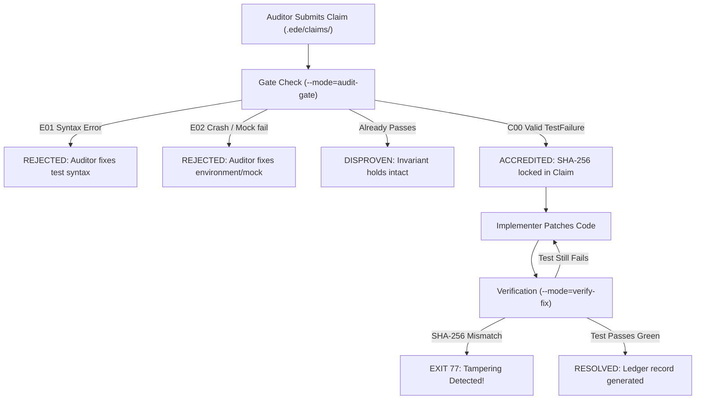

# Dissent Preservation, Debt Ledger & PR Evidence (EDE v3.1)

## Core Principle
> "Majority vote does not equal truth. In engineering, one reproducible, accredited failing test overrules ten approving reviews."

---

## 1. Test Accreditation & Dissent Lifecycle



---

## 2. Anti-Tampering Enforcement (Exit Code 77)
When a test is accredited (`C00_VALID_FALSIFICATION`), its `sha256` hash is stamped into `locked_hash`.
During `--mode=verify-fix`:
- The runner recalculates `sha256(counterexample_test)`.
- If the implementer modified the test to force a green result, the runner aborts with **Exit code 77 (`TAMPERING_DETECTED`)**.
- The implementer is restricted to fixing the implementation code only.

---

## 3. Spec Challenge (Circuit Breaker)
If the implementer believes the auditor's test violates the authoritative contract specification:
```bash
dart run tool/ede/run_debate_falsification.dart .ede/claims/<claim>.yaml --challenge-with="Breaks Contract Spec Section 4.2"
```
- Maximum 1 dispute round allowed.
- Moves the claim to `QUARANTINED_PENDING_ARBITRATION` with citation evidence.
- Prevents infinite back-and-forth arguments.
