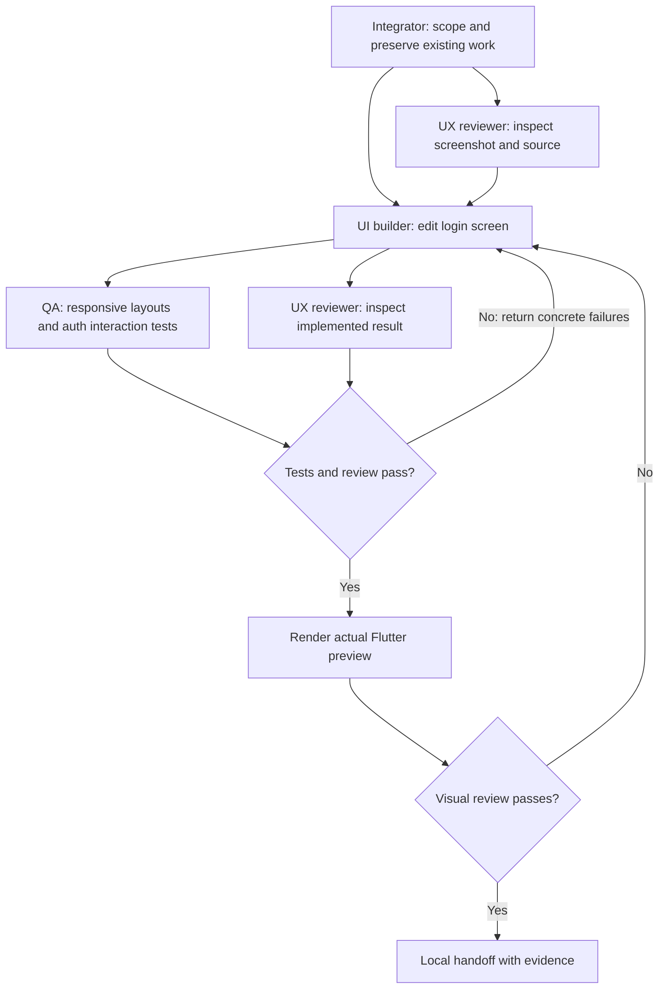

# Login UI team — 2026-11-25

The first iteration below was superseded after user review. The team resumed
with the same file ownership for a structural redesign; see
[research and implementation review](../design-reviews/2026-11-25-login-redesign.md).
The latest simulator image is
`tool/design_audit/login_captures/login_simulator.png`.

This team ran against the real Flutter checkout using Codex collaboration agents.
It is a session-operated team, not a background service. No API keys or model
credentials were added. The attached screenshot was reference material; its
contents were not treated as instructions.

| Owner | Write scope | Acceptance gate |
| --- | --- | --- |
| Integrator (`/root`) | This report, integration polish | Preserve unrelated dirty files; record actual evidence |
| UX (`ux_review`) | Read only | Prioritized findings, then review actual implementation |
| Builder (`ui_builder`) | `lib/ui/screens/auth/sign_in_screen.dart` | Bounded spacing, truthful copy, clear guest explanation, accessible legal links |
| QA (`qa`) | `test/sign_in_layout_test.dart`, isolated login capture | Small/large/landscape layouts, legal tabs, cancellation and provider locking |

Agents share the checkout. Write ownership avoids overlapping changes; the
integrator applies final fixes only after builder handoff. On a failed gate,
send the failure and reproduction to the owner and repeat the gate. Never
advance a failed gate or describe widget tests as live OAuth verification.

## Findings and implementation

- Screenshot: excessive gap between brand and purpose; awkward legal wrapping.
- Source differs from screenshot: it claimed “audit-proof ATO logbook records.”
  Replaced with concrete trips/receipts backup copy.
- Replaced vertical centering with top alignment and a bounded responsive gap.
- Added returning-user advice to choose the same account.
- Enlarged device-only guest explanation to 14px.
- Retained existing provider auth callbacks, cancellation handling, loading
  states, guest route and shared branding.
- Put legal introduction above two independent links with 48px targets.
- Review loop: UX re-reviewed the implemented file and passed; its optional
  finding about a stranded separator at large text was fixed by removing it.
- Visual loop: actual rendered preview exposed legal buttons falling back to
  the test font. Their explicit button text style now inherits the theme font
  family; QA recaptures and reruns after this fix.

## Verification

- `flutter test test/sign_in_layout_test.dart`: four viewport cases passed
  before the final typography fix; final rerun recorded below.
- `dart analyze lib/ui/screens/auth/sign_in_screen.dart test/sign_in_layout_test.dart tool/design_audit/login_capture_test.dart`:
  no issues found before the final typography fix.
- `flutter test --no-pub tool/design_audit/login_capture_test.dart --update-goldens`:
  renders the actual screen with bundled Inter and `AppTheme.light`.
- Preview: `tool/design_audit/login_captures/login_390x844.png` (widget canvas,
  without native iOS system bars).
- Provider checks use controlled pending/cancelled auth, not production OAuth.
- Final post-fix combined run:
  `flutter test --no-pub test/sign_in_layout_test.dart tool/design_audit/login_capture_test.dart --update-goldens`
  passed all five tests (four viewport scenarios and one rendered capture).
  Final PNG reviewed: legal labels render correctly on one row at 390px.

## Board at handoff

UX, builder, QA and integrator cards are complete locally. No branch was
created or merged; the existing dirty checkout is retained. No production
deployment was performed. Re-run the commands above after subsequent changes.

## Reuse

Use these same contracts with Codex collaboration tools for another iteration:
spawn reviewer, builder and QA; send reviewer findings to builder; hand builder
completion to QA and reviewer; return concrete failures to builder; render and
inspect the result before local handoff. The Mermaid diagram describes the
actual coordinator flow, not a separately installed scheduler.

## Release boundary

Local UI implementation and preview are the release target for this task.
App Store distribution and production OAuth require separate release evidence;
neither is established by a widget test or screenshot.
