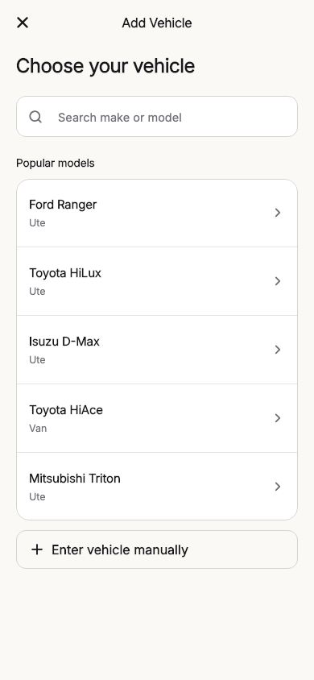
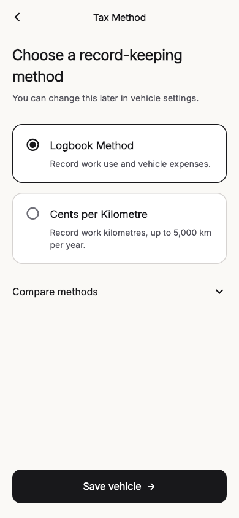
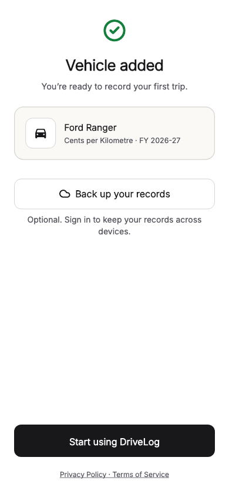

# Onboarding refinement — 11 November 2026

Implemented in the existing Flutter screens. Preview images below are widget renders at 390 × 844 logical pixels, not device screenshots.

- Vehicle selection: removed repeated vehicle icon badges and redundant helper text; promoted manual entry to a full-width control.
- Tax method: concise options, no vehicle-type recommendation badge, selected-state accessibility semantics, expandable comparison, corrected actual-expenses description.
- Success: confirmation first, method and financial year in the vehicle summary, optional expandable backup providers, persistent guest continuation at the bottom.
- Provider controls grow with text instead of enforcing a fixed height.

## Previews

| Vehicle | Method | Success |
| --- | --- | --- |
|  |  |  |

## Validation

- 11 existing targeted widget tests passed, covering vehicle creation, method selection, commercial eligibility, manual entry and onboarding continuation.
- Two visual checks passed at 100% and 200% text, including expanded backup options and tappable Google sign-in.
- Static analysis of the changed screens and tests passed.
- iOS Simulator debug build passed (Xcode, 95.8 seconds).
- Authentication provider network calls and Bluetooth hardware were not exercised by widget tests.

Tax record-keeping copy was checked against [ATO guidance](https://www.ato.gov.au/api/public/content/0-27f25397-ff76-467b-9b9a-90c639267d0e). The UI comparison is a short overview, not a replacement for the full requirements.
