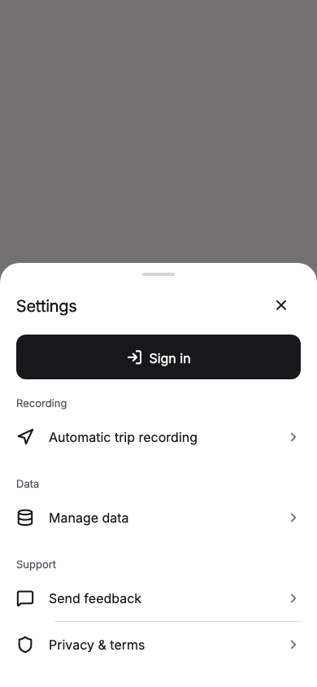

# Settings refinement — 11 November 2026

The first sheet now starts with a prominent Sign in button for guests, followed by consistent rows grouped under Recording, Data and Support. Account & sync appears only after authentication, with one compact sync status.

- Removed duplicated on-device status block, icon containers, promotional backup card, inline provider buttons and small legal links from the first view.
- Sign in opens Apple and Google directly, without export or other backup controls. The button disappears after authentication.
- Account & sync appears only for authenticated users and contains account details, sync status and manual sync.
- Guests see Sign in only. Export backup file is available only in Manage data.
- Manage data contains file export, authenticated sign-out and guarded deletion/reset. The existing confirmation flows remain intact.
- Privacy & terms opens the existing legal document sheet with full-size navigation targets.
- Detail views have explicit back and close actions. The sheet listens to AppState so authentication and sync updates render while open.

Main settings and backup previews are Flutter widget renders, not device screenshots.

| Settings | Sign in |
| --- | --- |
|  |  |

## Design rationale

Hierarchy: Settings is a list of destinations; provider actions appear only inside Sign in.
Consistency: aligned outline icons, consistent row typography, no nested card borders.
Progressive disclosure: authentication and destructive account operations require choosing the corresponding destination.
Ergonomics: minimum 48-point header controls, content-sized rows and buttons, scrolling at large text sizes.

## Validation scope

Widget tests exercise guest navigation, backup provider visibility, export availability, reset cancellation and authenticated deletion failure. Visual checks cover 390-point width at 100% text and 320-point width at 200% text. Live OAuth and file-sharing integrations are outside the widget-test scope.

Final validation: all seven functional tests and both responsive visual checks passed. Static analysis reported no issues. iOS Simulator debug build passed in 68.9 seconds.
