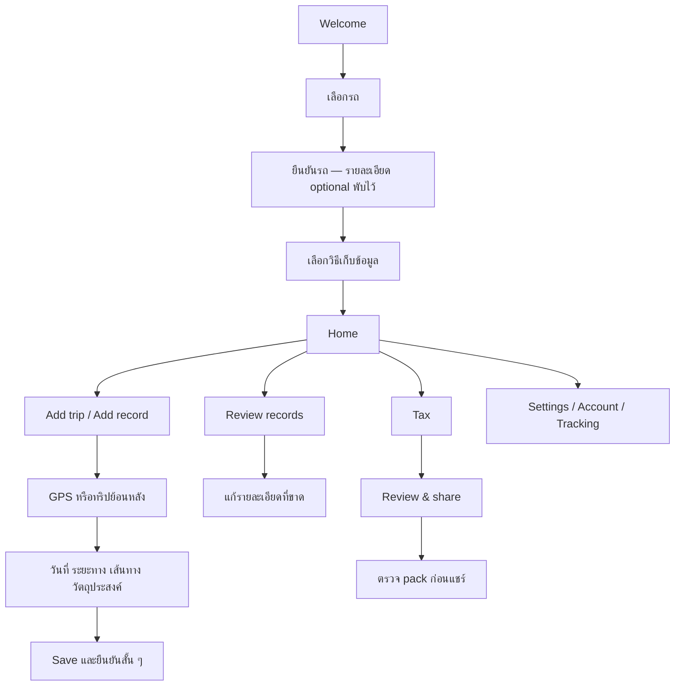

# DriveLog / KiloClaim — User-centric journey audit

วันที่: 9 พฤศจิกายน 2026

เป้าหมาย: เปลี่ยนหน้าที่ใช้พื้นที่กับคำโปรย ยอดเงิน และสถานะเชิงโฆษณา ให้เป็นเครื่องมือที่ตอบว่า “มีอะไรต้องทำต่อ และทำได้จากตรงไหน”

## ขอบเขตและวิธีตรวจ

ตรวจโค้ดและเรนเดอร์ Flutter widgets ของ Welcome, เลือกรถ, ยืนยันรถ, เลือกวิธีภาษี, sign-in, Home แบบ Cents/km และ Logbook, Home ที่ยังไม่มีทริป, Trips, Tax, Expenses, เพิ่มทริปทั้งสองวิธี, tracking setup, trip detail, receipt capture, expense entry, evidence review, Settings และ expense filters

ตรวจที่ความกว้าง 390pt / ตัวอักษร 100% และ 320pt / ตัวอักษร 200% รวมการเปิด optional vehicle details, record checklist, capture choices และ Settings ใช้ theme เดียวกับแอปจริง ไม่กลืน layout exceptions ใน harness ใหม่

นี่เป็น implementation และ layout audit ไม่ใช่ผล usability study และยังไม่ยืนยันพฤติกรรมของ native permission, OAuth หรือ background tracking บนเครื่องจริง

## 1. Visual Hierarchy & Information Architecture

| ปัญหาที่พบ | ผลต่อผู้ใช้ | สิ่งที่ปรับ |
| --- | --- | --- |
| Home ให้อันดับแรกกับคำชวนสมัครและยอด deduction ขนาดใหญ่ | งานที่ต้องตรวจและประวัติทริปอยู่ต่ำลง | ใช้ลำดับ Your records → งานที่ต้องตรวจ → Recent trips → สถานะ tracking → สรุป FY |
| มีทั้งยอดเงิน, arc gauge, progress bar และจำนวน km remaining สำหรับข้อมูลชุดเดียว | ความสำคัญของงานกับสถิติแยกไม่ออก | Home เหลือสรุปจำนวนทริป/ระยะทาง และแสดง estimate กับขีดจำกัดใน Tax |
| ข้อมูลสมัครบัญชีใช้การ์ดใหญ่ก่อนทริปล่าสุด | แย่งความสนใจจากงานประจำ | ย้ายเป็นรายการ Account and backup options ด้านล่าง และยังเข้า Settings ได้จาก header |
| Recent activity ใช้ latest-trip hero พร้อมรายละเอียดหลายประเภท | มองย้อนหลังหรือเปิดทริปที่ต้องการได้ช้า | แสดง 3 ทริปล่าสุด เรียงตามวันที่ พร้อมสถานที่ วันที่ ระยะทาง และสถานะ review |
| Tax วาง checklist ยาวและแบนเนอร์ “advantage” ที่ล้นแนวนอน | อ่านภาพรวมและหาจุด share ยาก | แสดง estimate หนึ่งชุด, evidence summary, checklist/compare แบบพับได้ และปุ่ม Review & share ที่จองพื้นที่ด้านล่าง |

## 2. Consistency & Visual Noise Reduction

| ปัญหาที่พบ | สิ่งที่ปรับ |
| --- | --- |
| Default controls กับปุ่ม custom ใช้รูปทรง สี และตัวอักษรต่างกัน | เพิ่ม `AppTheme.light` สำหรับ typography, app bars, buttons, cards, inputs และใช้ theme นี้ใน app และ visual harness |
| Sign-in มีตรารับรอง คำโปรย โลโก้เคลื่อนไหว และกรอบซ้อน | เหลือคำอธิบายบัญชีที่ต้องใช้, Apple/Google, ทางใช้ต่อโดยไม่มีบัญชี และ legal links |
| หลังบันทึกทริปเปิด modal เน้นยอดเงิน | เปลี่ยนเป็นข้อความยืนยันวันที่ ระยะทาง และการบันทึกสำเร็จ |
| Expense ที่ไม่มีรูปใช้กรอบเตือนทั้งใบซ้ำกัน | ใช้กรอบกลาง และเก็บคำว่า No photo ไว้เป็นสถานะเฉพาะจุด |
| Settings ใช้ Cloud Vault / 5-Year Shield และบอกว่า backup active ทันทีหลัง sign-in | ใช้สถานะ account และ sync ที่แยกกัน: ไม่มี completed sync, syncing, synced ตามเวลา หรือ sync needs attention |
| Label บางตัวสื่อ action มากกว่าสิ่งที่เปิดจริง | เปลี่ยน View profile, Review next, Add a past trip และ Record with GPS ให้ตรงงานที่ทำ |

## 3. Progressive Disclosure & Simplicity

| ปัญหาที่พบ | สิ่งที่ปรับ |
| --- | --- |
| ทะเบียนและเลขไมล์เป็น optional แต่แสดงเต็มหน้า confirm | พับไว้ใน Registration & odometer (optional) และยังตรวจค่าที่ผู้ใช้กรอก |
| เลือก Logbook แล้วเริ่มนับช่วงทันที | การเลือกวิธีเก็บข้อมูลไม่เริ่มช่วงเวลา ผู้ใช้เลือกวันเริ่มและ opening reading ใน Logbook setup |
| Job reference กับยอด estimate แข่งกับ route/purpose ในฟอร์ม Cents/km | แยกเป็น disclosure; วันที่ ระยะทาง เส้นทาง และวัตถุประสงค์อยู่ในเส้นทางหลัก |
| Checklist และ method comparison แสดงเต็มแม้ยังไม่ต้องใช้ | เปิดดูได้จาก Tax โดยไม่ต้องอ่านก่อนทุกครั้ง |
| Filter sheet เปลี่ยนผลทันที แต่ปุ่มเขียน Apply | ใช้ draft filters; Apply จึงเปลี่ยนรายการ การปิดแผงยกเลิก draft |
| ผู้ใช้ข้าม location แล้วอาจไม่เข้าใจสถานะ | คง manual fallback และหน้า tracking setup ที่แยก foreground/background/car connection |

## 4. Navigation & Thumb Zone Ergonomics

| ปัญหาที่พบ | สิ่งที่ปรับ |
| --- | --- |
| Cents/km ไม่มีทางเพิ่มทริปด้านล่างที่สม่ำเสมอกับ Logbook | เพิ่ม creation toolbar ด้านล่างสำหรับ Home/Trips ทั้งสองวิธี |
| Floating controls อาจทับข้อมูล | แถบเพิ่มข้อมูลและ navigation จองพื้นที่จริง ไม่วางทับรายการ |
| Navigation island ใช้เงา/blur และพื้นที่มาก | ใช้พื้นเรียบ เส้นแบ่งเบา label ที่อ่านได้ และ semantic selected state |
| ปุ่ม Save ของฟอร์ม Cents/km อยู่ท้ายเนื้อหาที่ต้องเลื่อน | ใช้ footer รูปแบบเดียวกับ Logbook; ยังคง scroll/keyboard dismissal ของฟอร์ม |
| Expense footer มีทั้ง Scan และ Add Expense ที่เปิดทางซ้ำกัน | เหลือ Add Expense หนึ่งปุ่มใน footer แล้วค่อยเลือก scan/manual; ทางลัด camera ยังอยู่ใน header |
| รายละเอียดและแผงบางส่วนล้นเมื่อขยายตัวอักษร | แก้ odometer heading, scrollable expense sheets, optional details และใช้พื้นที่แตะอย่างน้อย 48 สำหรับ action ที่ปรับ |

## ปัญหาด้านความหมายของข้อมูลที่พบระหว่าง audit

- Cents/km manual entry ไม่มีตัวเลือกวันที่ และบันทึกเป็นวันปัจจุบัน: เพิ่ม date picker และบันทึกวันที่ที่เลือก
- ช่อง route ที่ว่างถูกแทนด้วยสถานที่สมมติ: ขอให้กรอกสถานที่จริงก่อนบันทึก แทนการสร้าง Work Site / Client Destination ให้เอง
- Tax screen บวก direct expenses อีกครั้ง ทั้งที่ `TaxCalculatorService` รวมไว้ใน `logbookClaim` แล้ว: ใช้ค่าจาก domain summary โดยตรง พร้อม regression test
- การ refresh สิทธิ์ location ล้มเหลวไม่ควรหยุดการประเมิน evidence review: แยก error handling สองงานนี้

## Journey หลังปรับ

Welcome motion คงเป็น entrance ครั้งเดียว 800ms และไม่ขวางการกดเริ่ม Reduce Motion แสดง state สุดท้ายทันที

## หลักฐานและการตรวจสอบ

- Visual harness: `tool/design_audit/user_centric_capture_test.dart`
- ภาพปัจจุบัน: `tool/design_audit/user_centric/after/`
- Regression tests ครอบคลุม task priority, labelled create action, progressive comparison, วันที่ทริป, route validation, direct-expense estimate, annual cap, draft filters, onboarding/motion, navigation, account, vehicle setup และ live trip continuity
- ภาพ `before/` เป็นหลักฐาน layout จาก legacy harness ซึ่งใช้ theme จำลองเดิมและมีปัญหา debug-shadow invariant จึงไม่ใช้เป็น pixel-perfect colour baseline หรือเป็นผลผ่านของ test
- ภาพ after ใช้ AppTheme จริง และตรวจ exceptions โดยตรง

ไม่ให้คะแนนความสวยหรืออ้าง conversion ที่เพิ่มขึ้น เพราะยังไม่มีข้อมูลทดสอบผู้ใช้ เป้าหมายที่ควรวัดต่อคือเวลาถึงทริปแรก จำนวนผู้ใช้ที่หาทางเพิ่ม/แก้ทริปได้ และความเข้าใจสถานะ recording

## ขอบเขตที่ยังต้องตรวจบนเครื่องจริง

Native location prompts, OAuth cancel/return, background capture, keyboard/gesture behaviour, VoiceOver/TalkBack และการใช้งานมือเดียวบนอุปกรณ์หลายขนาด ยังต้องทำ device QA เพิ่ม การ capture ไม่ได้อนุญาต location, เปิดกล้อง หรือส่งข้อมูลออกจริง

เส้นทาง commercial / actual-expenses มี chooser ที่ต่างจากสองวิธีหลัก การ audit นี้ไม่ถือเป็นการรับรองความถูกต้องของ eligibility หรือการคำนวณภาษีทุกกรณี

## หลักการอ้างอิง

- [Apple — Layout](https://developer.apple.com/design/human-interface-guidelines/layout): hierarchy, progressive disclosure, safe areas
- [Apple — Tab bars](https://developer.apple.com/design/human-interface-guidelines/tab-bars): แยกจุดหมายหลักและรักษาการเข้าถึงที่สม่ำเสมอ
- [Android — Touch target size](https://support.google.com/accessibility/android/answer/7101858): พื้นที่แตะอย่างน้อย 48dp

## ผลตรวจรอบส่งมอบ

- Regression cases ที่เกี่ยวข้อง 65 กรณีผ่าน หลังแก้ assertion ของ sharing test ให้ตรวจปุ่มที่มองเห็นและกดได้ แทนข้อความในส่วนที่ยังไม่ถูกสร้างโดย lazy list
- Visual harness ผ่าน 2 กรณีหลัก ครอบคลุมภาพ 20 หน้าหรือแผง × 2 ขนาดตัวอักษร = 40 ภาพ และตรวจการเปิด disclosure/capture choices เพิ่ม
- `flutter analyze --no-pub`: No issues found
- `git diff --check` สำหรับไฟล์ที่ปรับ: ผ่าน
- [ภาพ Home และ Tax หลังปรับ](../../tool/design_audit/user_centric/after/home-and-tax.png)
- [ภาพรวม Sign-in / Home / Expenses / Tax](../../tool/design_audit/user_centric/after/overview.png)
